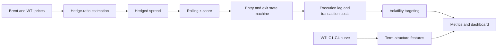

# Brent-WTI Statistical Arbitrage and WTI Term Structure

Python research project on the relative-value relationship between Brent and WTI crude-oil futures. The project combines cointegration diagnostics, dynamic hedge-ratio estimation, a walk-forward mean-reversion backtest, volatility targeting, regime analysis, and WTI futures-curve indicators.

[](https://brent-wti-stat-arb.streamlit.app/)

**Live dashboard:** [brent-wti-stat-arb.streamlit.app](https://brent-wti-stat-arb.streamlit.app/)

The interface is available in English and French. This is a research and educational project, not an investment recommendation or a production trading system.

## Research objective

Brent and WTI respond to common global oil-market factors but can diverge because of regional inventories, transport constraints, crude quality, export policy, and market structure. The project studies whether unusually large deviations in a hedged Brent-WTI spread subsequently mean-revert.

The core relationship is:

```text
Brent_t = alpha_t + beta_t * WTI_t + residual_t
```

The strategy estimates the hedge ratio `beta`, standardises the spread with a rolling z-score, and takes a relative-value position when the deviation exceeds a defined threshold.

## Dashboard guide

### Sidebar controls

| Control | Purpose |
|---|---|
| Price source | Switches between front-month futures and FRED spot prices. |
| Hedge ratio | Selects Kalman, rolling OLS, or static OLS estimation. |
| Z-score lookback | Sets the rolling window used to estimate the spread mean and standard deviation. |
| Entry threshold | Opens a position when the absolute z-score exceeds this value. |
| Exit threshold | Closes a position after the spread returns toward its rolling mean. |
| Time stop | Closes positions that remain open beyond the selected number of sessions. |
| Costs per leg | Applies bid-ask and commission assumptions to both legs. |
| Volatility targeting | Scales exposure to a selected annualised volatility target. |
| Advanced settings | Controls the Kalman state-noise parameter, rolling-OLS window, and optional z-score stop. |

### 1. Overview

The overview summarises the selected configuration and its main outputs:

- cumulative constant-notional P&L, annualised return, Sharpe ratio, and maximum drawdown;
- full-sample cointegration statistics, estimated half-life, Hurst exponent, and current z-score;
- dynamically hedged spread with rolling mean and entry bands;
- performance by predefined oil-market regime;
- current Brent and WTI legs, hedge ratio, spread level, and signal state;
- optional Brent and WTI price history with major market events.

### 2. Cointegration and regimes

This section examines whether the statistical relationship is stable through time:

- full-sample Engle-Granger and residual ADF tests;
- rolling 252-session cointegration p-value;
- dynamic hedge ratio compared with a 252-session rolling OLS estimate;
- rolling mean-reversion half-life;
- CUSUM break diagnostics on the hedge ratio;
- a descriptive tradability flag based on rolling cointegration and half-life conditions.

CUSUM break dates are retrospective diagnostics and are not used as causal trading signals.

### 3. WTI curve

The curve section uses EIA WTI contracts `C1` to `C4` to describe futures term structure:

- historical curve for a user-selected date;
- contango, backwardation, and flat-regime frequencies;
- `C4 - C1` slope and approximate annualised roll yield;
- relationship between curve regime and the Brent-WTI price spread;
- 21-session WTI forward returns by curve regime, with a significance diagnostic.

The EIA discontinued the `RCLC` series after 5 April 2024, so this section ends on that date. It covers the WTI curve only; no equivalent free Brent curve is included.

### 4. Backtest

The backtest section reports:

- Sharpe ratio, annualised return and volatility, maximum drawdown, trade count, and hit rate;
- cumulative P&L for the raw and volatility-managed strategies;
- a buy-and-hold Brent reference series;
- constant-notional drawdown and rolling one-year Sharpe ratio;
- comparison of online Kalman estimation, quarterly walk-forward blocks, and a single pre-2018 split;
- performance across six economic and oil-market regimes;
- two documented failure modes: structural relationship breaks and abnormal prices.

### 5. Trades and sensitivity

This section focuses on robustness rather than a single headline result:

- Sharpe sensitivity across entry thresholds and z-score lookbacks;
- sensitivity to transaction-cost assumptions;
- trade count, hit rate, average gain and loss, profit factor, and holding period;
- individual entry and exit dates, direction, z-scores, hedge ratios, position sizes, and net P&L.

## Baseline specification

The stored reference results use the following configuration:

| Parameter | Baseline value |
|---|---:|
| Price source | Front-month futures |
| Hedge estimator | Online Kalman filter |
| Z-score lookback | 40 sessions |
| Entry / exit | `|z| > 2.0` / `|z| < 0.5` |
| Maximum holding period | 90 sessions |
| Transaction cost | 2.5 bps per leg |
| Volatility target | 10% annualised |
| Maximum leverage | 3.0x |
| Entry hedge-ratio range | 0.5 to 1.5 |
| Warm-up period | 252 sessions |

The hedge-ratio and positive-price entry checks exclude positions that no longer represent an economically meaningful Brent-WTI spread, including the negative-WTI episode of April 2020.

## Reference results

Reference period: **30 July 2007 to 16 September 2026**, covering **4,761 trading sessions**. The first 252 sessions are used as a warm-up period.

| Metric | Raw strategy | Volatility-managed |
|---|---:|---:|
| Annualised return | 4.1% | 4.5% |
| Annualised volatility | 9.1% | 9.9% |
| Sharpe ratio | 0.45 | 0.45 |
| Maximum drawdown | -20.3% | -20.1% |
| Sortino ratio | 0.64 | 0.66 |
| Trades | 73 | 73 |
| Hit rate | 59% | 55% |
| Profit factor | 2.74 | 2.15 |

These figures describe one baseline specification and are not presented as stable expected returns. The dashboard exposes parameter sensitivity, transaction-cost sensitivity, execution-lag results, and regime-level breakdowns. Across the stored entry/lookback grid, the volatility-managed Sharpe ratio ranges from approximately **0.21 to 0.59**.

Selected statistical diagnostics for the full-sample static relationship:

| Diagnostic | Value |
|---|---:|
| Static cointegrating beta | 1.057 |
| Engle-Granger p-value | 0.013 |
| Residual ADF p-value | 0.003 |
| Estimated half-life | 18.9 sessions |
| Hurst exponent | 0.29 |

## Methodology

1. Load and align Brent and WTI price series.
2. Estimate a static, rolling, or dynamic hedge ratio.
3. Construct the hedged spread and rolling z-score.
4. Generate stateful entry, exit, and time-stop signals.
5. Shift execution to prevent the strategy from acting on unavailable information.
6. Apply costs to entries, exits, and volatility-target rebalancing.
7. Calculate constant-notional P&L and risk statistics.
8. Evaluate stability across time periods, parameter grids, costs, and execution assumptions.

The online Kalman filter and rolling statistics use information available up to each observation. End-to-end tests verify that running the pipeline on a historical prefix produces the same overlapping returns as running it on the complete dataset.

## Implementation overview



| Component | Main file | Responsibility |
|---|---|---|
| Hedge estimation | [`src/hedge_ratio.py`](src/hedge_ratio.py) | Static OLS, rolling OLS, and online Kalman filter |
| Signal generation | [`src/signal.py`](src/signal.py) | Spread, z-score, entry guard, and position state machine |
| Backtest engine | [`src/backtest.py`](src/backtest.py) | Execution lag, locked hedge ratios, P&L, costs, and trade records |
| Risk scaling | [`src/sizing.py`](src/sizing.py) | Causal realised volatility and volatility-target overlay |
| Statistical tests | [`src/stats_tests.py`](src/stats_tests.py) | ADF, Engle-Granger, half-life, and Hurst diagnostics |
| Regime analysis | [`src/regime.py`](src/regime.py) | Rolling cointegration, half-life, and CUSUM diagnostics |
| WTI curve | [`src/curve.py`](src/curve.py) | Curve slope, regimes, roll yield, and forward-return analysis |
| Pipeline | [`src/pipeline.py`](src/pipeline.py) | End-to-end orchestration shared by scripts and dashboard |

The excerpts below are shortened for readability. The linked modules contain the complete implementations and validation checks.

<details>
<summary><strong>Online Kalman hedge ratio</strong></summary>

The state vector contains the time-varying intercept and hedge ratio. Each observation updates the estimate without using future prices.

```python
theta = np.zeros(2)                 # [alpha, beta]
P = np.eye(2)

for t in range(n):
    H = np.array([1.0, xx[t]])
    P_pred = P + Q

    innovation = yy[t] - H @ theta
    innovation_var = float(H @ P_pred @ H.T + R)
    gain = (P_pred @ H) / innovation_var

    theta = theta + gain * innovation
    P = P_pred - np.outer(gain, H) @ P_pred
    beta_arr[t] = theta[1]
```

Full implementation: [`kalman_hedge`](src/hedge_ratio.py)

</details>

<details>
<summary><strong>Spread, rolling z-score, and entry guard</strong></summary>

The trading spread uses the dynamic hedge ratio. The entry guard rejects non-positive prices and hedge ratios outside the configured economic range.

```python
spread = (y - beta * x).rename("resid")

rolling_mean = spread.rolling(cfg.z_lookback).mean()
rolling_std = spread.rolling(cfg.z_lookback).std(ddof=1)
zscore = (spread - rolling_mean) / rolling_std

can_enter = (y > 0) & (x > 0) & beta.notna()
can_enter &= beta.between(cfg.beta_min, cfg.beta_max)
positions = generate_signals(zscore, cfg, can_enter=can_enter)
```

Full implementation: [`build_signal`](src/signal.py)

</details>

<details>
<summary><strong>Lagged execution, two-leg P&amp;L, and transaction costs</strong></summary>

Signals and hedge ratios are shifted before use. Daily P&L is calculated from both legs, while costs are applied to absolute turnover.

```python
lag = max(1, cfg.execution_lag)
held = np.concatenate([np.zeros(lag), target[:-lag]])
beta_signal = np.concatenate([np.full(lag, np.nan), beta[:-lag]])

pnl = (
    brent_units * (brent[t] - brent[t - 1])
    + wti_units * (wti[t] - wti[t - 1])
)
turnover = (
    abs(brent_units - previous_brent_units) * abs(brent[t - 1])
    + abs(wti_units - previous_wti_units) * abs(wti[t - 1])
)
net_pnl = pnl - cost_per_leg * turnover
```

Full implementation: [`_simulate`](src/backtest.py)

</details>

<details>
<summary><strong>Causal volatility targeting</strong></summary>

Risk is estimated from an always-invested hedged spread rather than strategy returns, which are zero while the strategy is flat. The additional shift ensures that the position multiplier uses volatility known before the holding period.

```python
lagged_beta = beta.shift(1)
gross_notional = y.shift(1).abs() + lagged_beta.abs() * x.shift(1).abs()
spread_return = (
    y.diff() - lagged_beta * x.diff()
) / gross_notional.where(gross_notional > 1e-8)

realised_vol = spread_return.rolling(21).std(ddof=1) * np.sqrt(252)
known_vol = realised_vol.shift(1)
scalar = (target_vol / known_vol).clip(0.0, max_leverage).fillna(0.0)
```

Full implementation: [`spread_returns` and `vol_target_scalar`](src/sizing.py)

</details>

## Data

| Dataset | Source | Use |
|---|---|---|
| Brent and WTI front-month futures | Yahoo Finance | Main tradable-price analysis and backtest |
| Brent and WTI spot prices | FRED | Alternative source and robustness checks |
| WTI contracts C1-C4 | U.S. EIA | Curve slope, contango/backwardation, and roll-yield analysis |

Cached parquet files are included so that the dashboard and reference results do not require a network request at startup. An EIA API key is only needed to refresh the WTI curve data.

## Project structure

```text
projet_petrole/
|-- dashboard/              Streamlit application, interface modules, and CSS
|-- src/                    Data, statistics, signals, backtest, risk, and pipeline modules
|-- scripts/                Data refresh and reference-result generation
|-- notebooks/              Exploration, cointegration, backtest, and curve analysis
|-- data/                   Cached input datasets
|-- results/                Metrics, equity, trades, regimes, and sensitivity outputs
|-- tests/                  Mathematical, schema, interface, and no-look-ahead tests
|-- report/                 Short research summary
|-- requirements.txt        Runtime dependencies
`-- requirements-dev.txt    Test dependencies
```

## Run locally

```bash
python -m venv .venv

# Windows
.venv\Scripts\activate

# macOS / Linux
source .venv/bin/activate

pip install -r requirements.txt
streamlit run dashboard/app.py
```

The local application is available at `http://localhost:8501`.

To refresh the datasets and regenerate the stored results:

```bash
python scripts/fetch_data.py
python scripts/run_backtest.py
```

To run the validation suite:

```bash
pip install -r requirements-dev.txt
pytest -q
```

## Main limitations

- Front-month continuous futures are not roll-adjusted. Contract changes can introduce price jumps that would not map directly to a live rolled position.
- The static full-sample cointegration test and the dynamically hedged trading spread are related but not identical statistical objects.
- Cointegration is not stable in every subperiod; the 2014-2016 structural break is a documented weak regime.
- Kalman results are sensitive to the observation-noise assumption.
- The baseline uses a close-based execution convention. Additional execution delay reduces performance.
- The time stop, entry guard, and removal of a z-score stop were selected with knowledge of the historical sample.
- The WTI curve dataset ends in April 2024 and does not include a Brent futures curve.
- Yahoo Finance data are appropriate for research and demonstration, not institutional execution or valuation.

## Disclaimer

This repository is provided for educational and research purposes. It does not constitute investment advice, a solicitation, or evidence of future trading performance.
